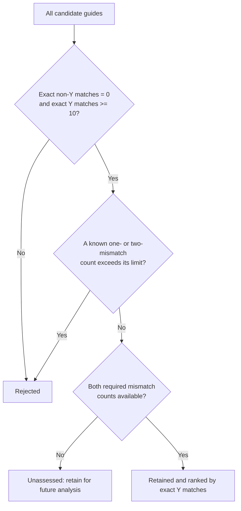

# Y-chromosome guide filtering

A new, explicit filtering pipeline that approximates the historical guide-selection logic using saved match tables. It records decisions for every guide, preserves missing annotations, and produces run-specific counts and Methods text. This is a **table-based reanalysis**; the original discovery/search and selection history remain documented in [the historical audit](filtering_audit_2026-09-16.md).

## First run: 16 September 2026

[Methods text and run summary](filtered_runs/2026-09-16_existing_tables_v1/methods_and_run_summary.md) · [Retained guides](filtered_runs/2026-09-16_existing_tables_v1/retained_guides.csv) · [Unassessed guides](filtered_runs/2026-09-16_existing_tables_v1/unassessed_guides.csv) · [Filtering counts](filtered_runs/2026-09-16_existing_tables_v1/filtering_counts.csv)

Of 14,723 candidates, **6,901** pass the exact-match criteria. Required mismatch annotations are available for **215**, all of which pass; **6,686** eligible guides remain unassessed. The other **7,822** candidates fail the exact-match criteria. All five named guides pass without exemptions. Six focused validation tests passed, and input/output hashes and the partition of every candidate were checked.

## Default filters

| Criterion | Setting |
|---|---|
| Exact Y matches, forward plus reverse | At least **10** |
| Exact non-Y matches, forward plus reverse | **0** |
| Non-Y sites with one mismatch | **0** |
| Non-Y sites with two mismatches | **0** |
| Missing required mismatch count | **Unassessed**, unless an observed criterion already establishes rejection |
| Three-/four-mismatch counts and legacy CFD values | Annotation only |
| Ordering | Exact Y matches descending; alphabetical spacer for ties |

The last rule makes tied ranks reproducible; it is a new implementation choice. No guide is automatically included because it was historically selected. Names and regional labels for Q53, CN, CP, P47 and P51 are annotations in [guide_labels.csv](guide_labels.csv).



## Run locally or on HPC

Python **3.9 or later**, standard library only. Paths in the JSON config resolve relative to the config file, so this entire directory can be copied to an HPC or another project location.

From this project folder:

```bash
python code/filter_guides.py --allow-partial
```

Or from any working directory:

```bash
python /path/to/sgRNA_guide_development/code/filter_guides.py --config /path/to/sgRNA_guide_development/filtering_config.json --allow-partial
```

The current inputs have incomplete mismatch coverage, so `--allow-partial` makes that run mode explicit. Without it, the script still writes diagnostic outputs and exits with code **2** when eligible guides lack required mismatch counts. Input errors exit with code **1**; a successful allowed run exits **0**. Missing rows or blank/NA counts never become zero.

Each run gets a new UTC-timestamped folder under `filtered_runs/`. To name it explicitly, add `--out /path/to/new_run_folder`. An existing destination is rejected, preserving previous drafts and outputs. Change thresholds in [filtering_config.json](filtering_config.json); the exact configuration and file checksums are saved with each run.

## Inputs and provenance

- **candidate_guides.csv:** all 14,723 unique 20-nt spacers, with chromosome-specific exact counts and `sumY`/`sumOther`. The pipeline verifies that all counts are non-negative integers and that both sums agree with the chromosome columns. chrMT denotes the mitochondrial genome.
- **filter_audit/saved_site_level_summary.csv:** non-Y mismatch counts and legacy CFD summaries, reconstructed from the saved 215-guide site-level RDS by [code/audit_top_hits.R](code/audit_top_hits.R). Its sites span chr1–22, chrX and chrM, with no chrY rows. The CFD columns already describe non-Y sites; no Y score is subtracted.
- **guide_labels.csv:** five historically selected guides, joined strictly by spacer sequence.
- **top_hits.csv:** used only after filtering, to compare retained-guide membership with the historical shortlist. It does not determine filtering decisions.

The site-level summary includes one mitochondrial four-mismatch site omitted from the condensed historical mismatch count. This affects the corresponding annotation, not the default one-/two-mismatch exclusion rule. See the audit for details. Legacy CFD input/PAM handling has not been revalidated; CFD values do not affect selection or rank.

### Adding broader mismatch results later

Point `inputs.non_y_mismatch_annotations` to a CSV with one row per guide and these columns:

| Column | Requirement |
|---|---|
| `guide` | Unique, 20-nt A/C/G/T spacer matching the candidate table |
| `mismatch_1`, `mismatch_2` | Required column headers; non-negative integer values when assessed; blanks/NA when unknown |
| `mismatch_3`, `mismatch_4` | Optional counts |
| `mismatch_mean_CFD`, `mismatch_max_CFD`, `mismatch_sum_CFD` | Optional legacy score annotations |
| `chrY_rows` | Optional scope check; must be zero if supplied |

Counts must refer to **non-Y** sites. For a completed search with no sites, provide explicit zeros. Omit a row or leave a required value blank when the search has not been completed. Do not infer zero from a missing site record. Record the actual search scope and reference in the config's provenance fields. The pipeline consumes annotations; it does not run the mismatch search or certify that its inputs exhaust the reference genome.

## Outputs

| File | Purpose |
|---|---|
| `all_guide_decisions.csv` | Every input guide, counts, annotations, decision and reason |
| `retained_guides.csv` | Guides passing all configured filters among those with sufficient annotations |
| `unassessed_guides.csv`, `.fasta` | Guides awaiting required mismatch counts |
| `rejected_guides.csv` | Guides failing an observed criterion |
| `named_guide_decisions.csv` | Decisions for the five labelled historical guides |
| `filtering_counts.csv` | Stage counts, separating filters from annotation coverage |
| `historical_comparison.csv` | Diagnostic membership comparison only |
| `methods_and_run_summary.md` | Procedure and actual run counts, with scope for thesis writing |
| `config_snapshot.json`, `run_manifest.json` | Settings, input/output hashes, software version and run status |

Agreement with the historical 215-guide set is expected because those are the guides with saved mismatch annotations. It is not independent evidence that the new rules recover every suitable guide among all 6,901 exact-match-eligible candidates.

## Validation

```bash
python -m unittest discover -s code -p "test_filter_guides.py" -v
```

Checks cover threshold boundaries, missing versus zero counts, partial annotations, known exclusions, deterministic ranks, duplicate guides, non-Y input scope, config-driven changes, provenance and output preservation.
